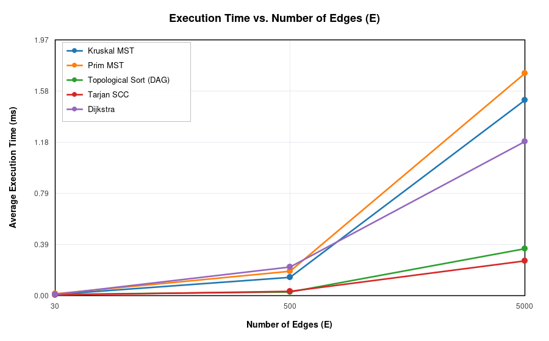
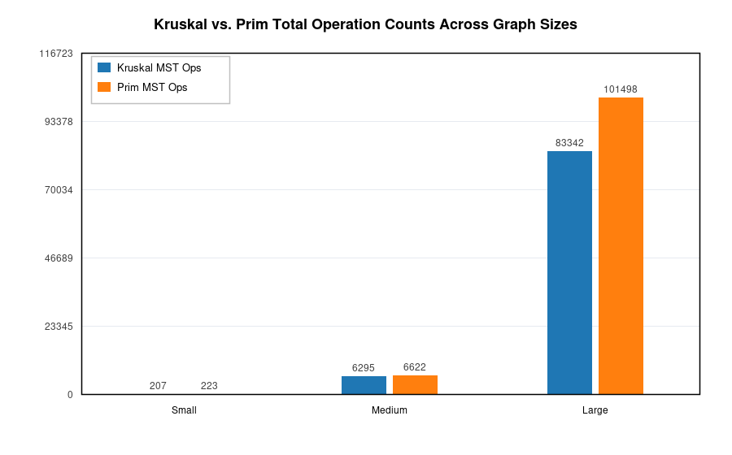

# Assignment 3 — Smart City Infrastructure and Route Planning

## 1. Overview

This application models a smart city's infrastructure and transportation network as a weighted graph $G = (V, E)$:
- **Vertices ($V$):** Represent city districts, hubs, and utility stations (e.g., *Downtown Hub*, *Tech Park*, *Hospital District*).
- **Edges ($E$):** Represent roads, utility corridors, or directed service dependencies between districts.
- **Weights ($w$):** Represent either road construction costs (for Minimum Spanning Tree infrastructure planning) or travel distances/times (for shortest-path route planning).

The system supports three core urban planning tasks:
1. **Minimum Spanning Tree (MST):** Finding the minimum-cost network that connects all city districts using both **Kruskal's algorithm** (with Disjoint Set Union) and **Prim's algorithm** (with a binary heap priority queue), while detecting whether the network is connected.
2. **Connectivity and Strongly Connected Components (SCC):** Modeling one-way roads and infrastructure service dependencies using **Kahn's Topological Sort** (with cycle detection) and **Tarjan's SCC algorithm**.
3. **Shortest Paths:** Computing optimal routes and travel distances from a source district to all reachable districts using **Dijkstra's algorithm**.

### Project Structure

```text
assignment-3/
├── src/
│   ├── graph/
│   │   ├── Edge.java
│   │   ├── Graph.java
│   │   └── GraphGenerator.java
│   ├── dsu/
│   │   └── DisjointSetUnion.java
│   ├── mst/
│   │   ├── MSTResult.java
│   │   ├── KruskalMST.java
│   │   └── PrimMST.java
│   ├── connectivity/
│   │   ├── TopologicalSort.java
│   │   └── TarjanSCC.java
│   ├── shortestpath/
│   │   └── Dijkstra.java
│   ├── TestSuite.java
│   └── Main.java
├── results/
│   ├── tables/
│   │   ├── mst_comparison.csv
│   │   ├── connectivity_results.csv
│   │   ├── dijkstra_results.csv
│   │   └── benchmark_summary.csv
│   └── plots/
│       ├── execution_time_vs_vertices.png
│       ├── execution_time_vs_edges.png
│       └── kruskal_vs_prim_operations.png
└── README.md
```

### How to Compile and Run

```bash
mkdir -p out
javac -d out src/graph/*.java src/dsu/*.java src/mst/*.java src/connectivity/*.java src/shortestpath/*.java src/*.java
java -cp out Main
```

---

## 2. Implementation

### Graph Representation
- `Graph` uses an **adjacency list** (`List<List<Edge>>`) alongside an explicit edge list (`List<Edge>`).
- Undirected graphs store symmetric directed edges $(u, v)$ and $(v, u)$ in the adjacency list for traversal in Prim's algorithm, while storing each undirected edge once in `getEdges()` for Kruskal's sorting step.
- Directed graphs store edges only in their forward direction.

### Disjoint Set Union (DSU)
- Implemented in `DisjointSetUnion` with both **path compression** inside `find(x)` (`parent[x] = find(parent[x])`) and **union by rank** (as well as tracking component `size` and total connected `components`).
- Path compression flattens trees during queries so subsequent lookups on the same path run in $O(1)$ time, while union by rank attaches shorter trees under taller roots to bound tree height by $O(\log V)$ even without compression. Together, $m$ operations on $V$ elements execute in $O(m \cdot \alpha(V))$ time, where $\alpha(V) \le 4$ is the inverse Ackermann function.

### Kruskal's vs. Prim's MST
- **Kruskal's Algorithm (`KruskalMST`):** Copies all edges, sorts them in ascending order of weight, and iterates through the sorted edges using `DisjointSetUnion` to greedily add edges that connect distinct components. Stops early as soon as $V - 1$ edges are added. Connectivity is confirmed when `mstEdges.size() == V - 1`.
- **Prim's Algorithm (`PrimMST`):** Starts from vertex $0$, maintains a `boolean[] visited` array, and pushes incident cross-edges into a binary-heap `PriorityQueue<Edge>`. Greedily extracts the minimum-weight edge leading to an unvisited vertex until all reachable vertices are visited. Connectivity is verified by checking `visitedCount == V`.

### Topological Ordering and SCC
- **Topological Sort (`TopologicalSort`):** Uses Kahn's in-degree algorithm. Computes in-degrees for all vertices in $O(V + E)$, pushes $0$-in-degree vertices into an `ArrayDeque`, and repeatedly removes vertices while decrementing neighbor in-degrees. If the resulting ordering has fewer than $V$ vertices, a directed cycle exists and the method reports `isDAG = false`.
- **Strongly Connected Components (`TarjanSCC`):** Uses Tarjan's single-pass DFS algorithm with discovery indices (`ids[]`), low-link values (`low[]`), and an explicit recursion stack (`Deque<Integer>` + `onStack[]`). Whenever `ids[u] == low[u]`, vertex $u$ is the root of an SCC and all vertices down to $u$ are popped into a component.

### Dijkstra's Shortest Paths
- Implemented in `Dijkstra` using a `PriorityQueue` (binary min-heap) over `(vertex, distance)` entries and lazy deletion (`if (current.dist > dist[u]) continue`).
- Tracks both `distances[]` (initialized to `Long.MAX_VALUE` for unreachable nodes) and `predecessors[]` to reconstruct the exact shortest path to any reachable district.
- Validates that all edge weights are non-negative.

#### Why Dijkstra's Algorithm Is Unsuitable for Negative Edge Weights
Dijkstra's algorithm relies on the greedy invariant that once a vertex $u$ is extracted from the priority queue with the minimum tentative distance $d[u]$, its shortest path distance is finalized and no future path through any unvisited vertex $v$ (with $d[v] \ge d[u]$) can produce a shorter distance to $u$. When negative edge weights exist, a path through a vertex $v$ with $d[v] > d[u]$ followed by a negative edge $(v, u)$ of weight $w(v, u) < 0$ can yield $d[v] + w(v, u) < d[u]$. Because $u$ was already popped and marked settled, lazy-deletion Dijkstra either ignores the update or (if re-insertions are allowed) degrades to exponential time $O(2^V)$ and fails completely on negative-weight cycles. For graphs with negative weights, the Bellman-Ford algorithm ($O(V \cdot E)$) is required.

---

## 3. Complexity Analysis

All analyses assume an **adjacency list** graph representation and a **binary heap** (`java.util.PriorityQueue`) for priority queue operations.

| Algorithm / Structure | Time Complexity | Space Complexity | Effect of $V$ and $E$ on Performance |
| :--- | :--- | :--- | :--- |
| **DSU (`find`, `union`)** | $O(\alpha(V))$ amortized per op; $O(m \cdot \alpha(V))$ for $m$ ops | $O(V)$ | Arrays `parent`, `rank`, and `size` scale linearly with $V$. Path compression + union by rank keep tree depth $\le 4$, making each edge check nearly independent of $V$. |
| **Kruskal's Algorithm** | $O(E \log E) = O(E \log V)$ | $O(V + E)$ | Dominated by sorting $E$ edges ($O(E \log E)$), followed by at most $E$ DSU `union`/`find` calls ($O(E \cdot \alpha(V))$). Performs best on sparse to moderately dense graphs where early termination after $V - 1$ tree edges skips remaining edges. |
| **Prim's Algorithm (Lazy Binary Heap)** | $O(E \log E) = O(E \log V)$ | $O(V + E)$ | Examines each adjacency list entry ($2E$ directed half-edges) and inserts up to $E$ edges into the binary heap. Each `offer`/`poll` takes $O(\log E)$. Heap overhead grows with edge density $E/V$. |
| **Tarjan's SCC Algorithm** | $O(V + E)$ | $O(V)$ | Performs a single DFS traversal: visits each vertex once ($O(V)$ stack/index updates) and inspects each directed edge once ($O(E)$). Scales strictly linearly with graph size $V + E$. |
| **Topological Ordering (Kahn's)** | $O(V + E)$ | $O(V)$ | Computes in-degrees by scanning all $E$ edges, then processes each vertex at most once in the queue and decrements in-degrees across outgoing edges ($O(V + E)$). |
| **Dijkstra's Algorithm (Binary Heap)** | $O((V + E) \log V)$ | $O(V + E)$ | Each vertex is settled once and each edge is relaxed at most once; successful relaxations push entries to the priority queue ($O(E \log V)$). |

---

## 4. Experimental Setup

### Graph Configurations
Experiments evaluate all required algorithms across three standard graph scales:

| Graph Configuration | Vertices ($V$) | Edges ($E$) | Average Degree ($2E/V$ undirected, $E/V$ directed) |
| :--- | :---: | :---: | :---: |
| **Small** | 10 | 30 | 6.0 / 3.0 |
| **Medium** | 100 | 500 | 10.0 / 5.0 |
| **Large** | 1,000 | 5,000 | 10.0 / 5.0 |

### Reproducible Graph Generation (`GraphGenerator`)
All graphs are generated deterministically using a fixed base random seed (`20261031L`):
1. **Connected Undirected Graphs (for MST):** First shuffles the $V$ vertices and constructs a random spanning tree of $V - 1$ edges by connecting each vertex $i \ge 1$ to a uniformly chosen predecessor in `[0, i - 1]`. Then adds random unique undirected edges until exactly $E$ edges exist, with random integer weights in $[1, 100]$. This guarantees connectivity.
2. **Directed Acyclic Graphs (DAGs):** Generates a random permutation of vertices $\pi$ and samples unique directed edges $(u, v)$ strictly following $\pi^{-1}(u) < \pi^{-1}(v)$ until $E$ edges are added. Because all edges point forward in $\pi$, the graph is guaranteed to be acyclic.
3. **Directed Cyclic Graphs (for SCC, Cyclic Topological Test, and Dijkstra):** Plants a guaranteed directed 3-cycle $0 \to 1 \to 2 \to 0$ and then adds random unique directed edges $(u, v)$ ($u \ne v$) with weights in $[1, 100]$ until $E$ edges are reached.

### Measurement Methodology
- **JIT Warmup:** Before timing, `Main.warmupJIT()` runs 15 warmup iterations on 200-vertex graphs so HotSpot JIT compilation does not skew the Small configuration.
- **Repetitions:** Each experiment is repeated **5 times** per graph size, and the average execution time is measured using `System.nanoTime()`.
- **Operation Counting:** Explicit counters record edge examinations, comparator invocations, DSU operations (`find` + `union` + parent accesses), binary heap operations (`offer` + `poll`), and DFS/queue visits.

---

## 5. Results

### Table 1: Minimum Spanning Tree — Kruskal vs. Prim (`results/tables/mst_comparison.csv`)

| Config | $V$ | $E$ | Algorithm | Avg Time (ns) | Avg Time (ms) | MST Weight | Connected | Edge Exams | Comparisons | DSU / Heap Ops | Total Ops |
| :--- | :---: | :---: | :--- | :---: | :---: | :---: | :---: | :---: | :---: | :---: | :---: |
| **Small** | 10 | 30 | Kruskal | 12,551 | 0.0126 | 160 | `true` | 11 | 110 | 86 | 207 |
| **Small** | 10 | 30 | Prim | 15,789 | 0.0158 | 160 | `true` | 60 | 122 | 41 | 223 |
| **Medium** | 100 | 500 | Kruskal | 141,949 | 0.1419 | 1,339 | `true` | 250 | 3,836 | 2,209 | 6,295 |
| **Medium** | 100 | 500 | Prim | 189,259 | 0.1893 | 1,339 | `true` | 1,000 | 4,873 | 749 | 6,622 |
| **Large** | 1,000 | 5,000 | Kruskal | 1,509,505 | 1.5095 | 12,805 | `true` | 3,298 | 50,403 | 29,641 | 83,342 |
| **Large** | 1,000 | 5,000 | Prim | 1,715,183 | 1.7152 | 12,805 | `true` | 10,000 | 83,180 | 8,318 | 101,498 |

### Table 2: Connectivity — Topological Sort & Tarjan's SCC (`results/tables/connectivity_results.csv`)

| Config | $V$ | $E$ | Graph Type | Algorithm | Avg Time (ns) | Avg Time (ms) | Result / SCCs | Vertex / DFS Visits | Edge Exams | Stack Ops | Total Ops |
| :--- | :---: | :---: | :--- | :--- | :---: | :---: | :---: | :---: | :---: | :---: | :---: |
| **Small** | 10 | 30 | DAG | TopologicalSort | 10,281 | 0.0103 | `DAG=true` | 20 | 60 | 0 | 80 |
| **Small** | 10 | 30 | Cyclic | TopologicalSort | 1,785 | 0.0018 | `DAG=false` | 12 | 34 | 0 | 46 |
| **Small** | 10 | 30 | DAG | TarjanSCC | 6,105 | 0.0061 | `SCCs=10` | 10 | 30 | 20 | 60 |
| **Small** | 10 | 30 | Cyclic | TarjanSCC | 4,959 | 0.0050 | `SCCs=3` | 10 | 30 | 20 | 60 |
| **Medium** | 100 | 500 | DAG | TopologicalSort | 30,603 | 0.0306 | `DAG=true` | 200 | 1,000 | 0 | 1,200 |
| **Medium** | 100 | 500 | Cyclic | TopologicalSort | 13,507 | 0.0135 | `DAG=false` | 100 | 500 | 0 | 600 |
| **Medium** | 100 | 500 | DAG | TarjanSCC | 24,483 | 0.0245 | `SCCs=100` | 100 | 500 | 200 | 800 |
| **Medium** | 100 | 500 | Cyclic | TarjanSCC | 35,757 | 0.0358 | `SCCs=1` | 100 | 500 | 200 | 800 |
| **Large** | 1,000 | 5,000 | DAG | TopologicalSort | 362,704 | 0.3627 | `DAG=true` | 2,000 | 10,000 | 0 | 12,000 |
| **Large** | 1,000 | 5,000 | Cyclic | TopologicalSort | 165,315 | 0.1653 | `DAG=false` | 1,006 | 5,028 | 0 | 6,034 |
| **Large** | 1,000 | 5,000 | DAG | TarjanSCC | 215,992 | 0.2160 | `SCCs=1000` | 1,000 | 5,000 | 2,000 | 8,000 |
| **Large** | 1,000 | 5,000 | Cyclic | TarjanSCC | 270,752 | 0.2708 | `SCCs=21` | 1,000 | 5,000 | 2,000 | 8,000 |

### Table 3: Dijkstra's Shortest Paths (`results/tables/dijkstra_results.csv`)

| Config | $V$ | $E$ | Algorithm | Avg Time (ns) | Avg Time (ms) | Reachable Vertices | Edge Relaxations | Comparisons | Heap Ops | Total Ops |
| :--- | :---: | :---: | :--- | :---: | :---: | :---: | :---: | :---: | :---: | :---: |
| **Small** | 10 | 30 | Dijkstra | 13,703 | 0.0137 | 8 / 10 | 26 | 66 | 22 | 114 |
| **Medium** | 100 | 500 | Dijkstra | 225,110 | 0.2251 | 100 / 100 | 500 | 2,144 | 290 | 2,934 |
| **Large** | 1,000 | 5,000 | Dijkstra | 1,192,858 | 1.1929 | 994 / 1000 | 4,972 | 30,274 | 2,854 | 38,100 |

### Plots

#### Plot 1: Execution Time vs. Number of Vertices ($V$)


#### Plot 2: Execution Time vs. Number of Edges ($E$)


#### Plot 3: Kruskal vs. Prim Operation Counts


---

## 6. Comparison and Discussion

1. **Kruskal vs. Prim (Execution Time and Operation Counts):**
   - Both algorithms return identical MST weights across all configurations (`160` on Small, `1,339` on Medium, and `12,805` on Large).
   - Kruskal consistently executes fewer total operations (`83,342` vs. `101,498` on Large) and achieves slightly lower average runtime (`1.51 ms` vs. `1.72 ms` on Large).
   - **Why:** Kruskal sorts a contiguous array of $E$ edges once ($50,403$ comparisons on Large) and stops scanning edges as soon as $V - 1 = 999$ edges are merged (examining only $3,298$ out of $5,000$ edges). Prim's lazy binary heap scans all $2E = 10,000$ adjacency list entries and performs $83,180$ heap comparisons due to duplicate cross-edges entering the priority queue. On very dense graphs ($E \approx V^2$), an indexed Prim implementation would overtake Kruskal because sorting $O(V^2)$ edges becomes a bottleneck.

2. **DSU Performance with Path Compression and Union by Rank:**
   - On the Large graph ($V = 1,000, E = 5,000$), Kruskal examines $3,298$ edges, invoking $3,298$ `union` calls and $6,596$ top-level `find` calls. The total DSU operations (`findCalls + unionCalls + parentAccesses`) is only `29,641`, meaning each `find` traverses on average fewer than $1.49$ parent pointers. This empirically confirms the near-constant $O(\alpha(V))$ amortized complexity enabled by path compression and union by rank.

3. **SCC Runtime Scaling:**
   - Tarjan's SCC algorithm performs `60`, `800`, and `8,000` total operations on Small, Medium, and Large graphs respectively—matching the exact formula $V \text{ (DFS calls)} + E \text{ (edge checks)} + 2V \text{ (stack push/pop)} = 3V + E$.
   - Execution time scales linearly with $V + E$, increasing from `0.005 ms` (Small) to `0.036 ms` (Medium) and `0.271 ms` (Large).

4. **Topological Ordering on DAGs vs. Cyclic Graphs:**
   - On DAGs, Kahn's algorithm processes every vertex and edge twice (once during in-degree computation and once during queue extraction), yielding `80`, `1,200`, and `12,000` operations ($2V + 2E$).
   - On cyclic graphs, vertices belonging to cycles never reach in-degree $0$, so the queue empties early (`46`, `600`, and `6,034` operations) and `isDAG()` immediately identifies the cycle.

5. **Dijkstra Across Graph Sizes:**
   - As the graph grows from Small ($V=10, E=30$) to Large ($V=1,000, E=5,000$), edge relaxations scale linearly with reachable edges (`26` $\to$ `500` $\to$ `4,972`), while priority queue comparisons grow super-linearly (`66` $\to$ `2,144` $\to$ `30,274`) due to the $\log V$ heap depth factor in $O((V + E) \log V)$.

---

## 7. Testing

All automated tests are implemented in `src/TestSuite.java` and executed automatically by `Main` (22 assertions, 0 failures):
- **Small graphs:** Verifies exact MST weight (`19`) on a 4-vertex benchmark graph for both Kruskal and Prim.
- **Disconnected graphs:** Tests a 5-vertex, 2-component graph and verifies that both `KruskalMST` and `PrimMST` return `isConnected() == false`.
- **Graphs containing cycles:** Tests a 4-vertex directed graph with a 3-cycle and verifies `TopologicalSort.sort()` returns `isDAG() == false` while `TarjanSCC` isolates the 3-vertex cycle and 1-vertex tail into 2 SCCs.
- **Graphs with multiple valid MSTs and duplicate edge weights:** Tests a 4-vertex graph where all edges have weight `5` and verifies both Kruskal and Prim select $V - 1 = 3$ edges with total weight `15`.
- **Graphs with unreachable vertices:** Verifies that `Dijkstra` reports `isReachable(v) == false`, `getDistance(v) == Long.MAX_VALUE`, and an empty path `[]` for isolated/unreachable districts.
- **Graphs with a single vertex:** Confirms $V = 1, E = 0$ works cleanly across Kruskal, Prim, Topological Sort, Tarjan SCC, and Dijkstra.
- **Cross-algorithm invariants:**
  - Kruskal and Prim return identical MST weights on Small, Medium, and Large random connected undirected graphs.
  - `TopologicalSort.isValidTopologicalOrder()` verifies that for every generated DAG, every edge $(u, v)$ satisfies $\text{pos}[u] < \text{pos}[v]$.
  - Every vertex belongs to exactly one SCC across all generated graphs.
  - Dijkstra rejects negative edge weights with an `IllegalArgumentException`.

---

## 8. Conclusion

- **Infrastructure Cost Minimization (MST):** Both Kruskal's and Prim's algorithms find optimal minimum-cost networks connecting all city districts. For sparse and moderately dense urban road networks ($E \le 5V$), **Kruskal's algorithm with DSU** is slightly faster and simpler to implement because array sorting has high cache locality and DSU operations run in $O(\alpha(V))$. **Prim's algorithm** is preferable when the graph is dense or already stored only as an adjacency list where materializing and sorting all edges is undesirable.
- **Connectivity and Service Dependencies (SCC & Topological Sort):** **Tarjan's algorithm** identifies strongly connected traffic zones in a single $O(V + E)$ DFS pass, while **Kahn's Topological Sort** both orders acyclic dependency chains and detects circular dependencies in $O(V + E)$ time.
- **Route Planning (Shortest Paths):** **Dijkstra's algorithm** efficiently computes single-source shortest paths in $O((V + E) \log V)$ time for non-negative road travel distances and reconstructs full district-to-district routes.
